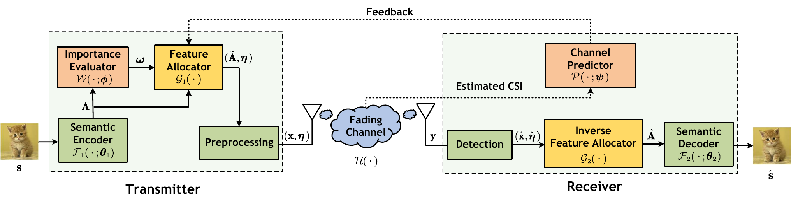

# FAST

PyTorch implementation of [Feature Allocation for Semantic Communication With Space-Time Importance Awareness (IEEE TWC 2025)](https://doi.org/10.1109/TWC.2025.3569320), extending the [WCNC 2024 paper](https://doi.org/10.1109/WCNC57260.2024.10570995). FAST uses feature importance and predicted channel quality to allocate image features across antennas and time slots.



## Requirements

Tested with Python 3.12.

```bash
python -m pip install -r requirements.txt
```

## Usage

Run the pretrained model on CIFAR-10. The first run downloads the dataset and saves an example reconstruction to `runs/reconstruction.png`.

```bash
python test.py
```

The default uses SVD precoding. For precoding-free transmission, use `--mode mmse`.

To train your own models, generate the channel data and run the three training stages.

```bash
python generate_csi.py
python train.py codec
python train.py importance
python train.py predictor
```

## Pretrained models

`checkpoints/` contains the pretrained codec, WNet, and CSI predictor for the 2 × 2 MIMO configuration at 13 dB.

The bundled WNet was trained on importance scores derived from the drop in reconstruction PSNR when each encoded feature map was masked in turn.

## Citation

<details>
<summary>BibTeX for the journal and conference papers</summary>

```bibtex
@article{zhou2025fast,
  author  = {Zhou, Kequan and Zhang, Guangyi and Cai, Yunlong and Hu, Qiyu and Yu, Guanding and Swindlehurst, A. Lee},
  title   = {Feature Allocation for Semantic Communication With Space-Time Importance Awareness},
  journal = {IEEE Trans. Wireless Commun.},
  year    = {2025},
  volume  = {24},
  number  = {10},
  pages   = {8847--8862},
  month   = {Oct.}
}

@inproceedings{zhou2024fast,
  author    = {Zhou, Kequan and Zhang, Guangyi and Cai, Yunlong and Hu, Qiyu and Yu, Guanding},
  title     = {{FAST}: Feature Arrangement for Semantic Transmission},
  booktitle = {Proc. IEEE Wireless Commun. Netw. Conf. (WCNC)},
  year      = {2024},
  pages     = {1--6},
  month     = {Apr.},
  address   = {Dubai, United Arab}
}
```

</details>

## License

The code and pretrained weights are released under the [MIT License](LICENSE).
